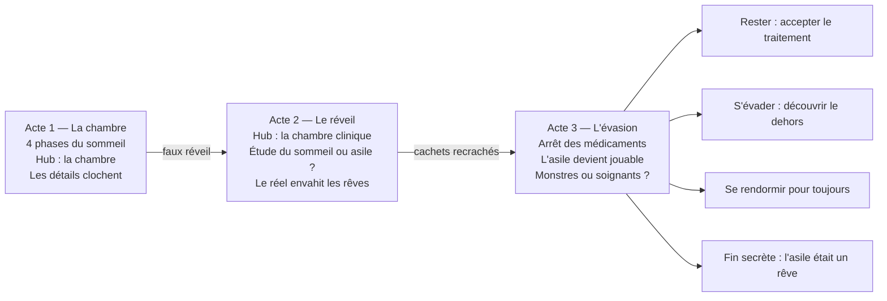

# Hypnagogia — Document de conception

20 novembre 2026

## Pitch et piliers

**Hypnagogia** est un roguelike twin-stick en 2D : un homme fait des rêves lucides sans savoir pourquoi, s'enfonce toujours plus profond dans le sommeil, et se réveille à chaque mort. Run après run, il découvre que son réveil n'est peut-être pas plus réel que ses rêves.

- **Action nerveuse et exigeante** : la mort énerve, mais elle est toujours méritée et donne envie de relancer.
- **Le thème explique les mécaniques** : mourir = se réveiller, la profondeur du sommeil = la difficulté, les pactes = perdre le contrôle.
- **Builds par synergies** : des objets qui se combinent et un personnage qui évolue pendant la run.
- **Un mystère qui se dévoile par couches** : chaque run révèle un fragment, sans jamais trancher trop vite entre rêve et réalité.

**Titre** : Hypnagogia (l'état entre veille et sommeil). **Motif récurrent** : 4:12, l'heure où l'horloge du hub s'arrête toujours ; sa signification n'est révélée qu'à la fin.

## Boucle de jeu

Une run = une nuit. On s'endort, on descend étage par étage, et la mort ramène au hub avec de nouveaux déblocages, jamais avec plus de puissance.

1. **S'endormir** depuis le hub (la chambre).
2. **Explorer un étage** : salles prédessinées assemblées aléatoirement, combats twin-stick, objets et consommables.
3. **Affronter le cauchemar** de l'étage.
4. **Choisir un pacte** avant de descendre : accepter une malédiction contre un pouvoir.
5. **Mourir = se réveiller** : retour au hub, l'heure de la mort s'affiche sur le réveil.
6. **Constater les déblocages** dans la chambre et le journal de rêves, puis se rendormir.

**Méta-progression : contenu uniquement.** Nouveaux objets, consommables, pactes, cauchemars, étages et fragments d'histoire. Aucune amélioration permanente de statistiques : un joueur qui gagne, c'est un joueur qui a progressé.

**Pas de choix de route** : la descente est linéaire d'un étage à l'autre ; les décisions passent par les objets, les consommables et les pactes.

## Histoire et mystère

Un homme fait des rêves lucides sans savoir pourquoi. Chaque mort le réveille, chaque run révèle un fragment, et chaque réveil se révèle être une couche de plus : la question centrale devient « qu'est-ce qui est réel ? ».

- **Le faux réveil** : la chambre du hub est elle-même un rêve. Les détails qui clochent s'accumulent jusqu'à la révélation.
- **Étude du sommeil ou asile** : le patient croit participer à une étude sur un somnifère expérimental ; les dossiers parlent d'internement psychiatrique. Même lieu, deux lectures.
- **Ne jamais trancher trop vite** : malade, ou victime d'un mensonge ? Le doute sur ce qu'on considère comme raisonnable est le cœur du récit.
- **4:12** : l'heure clé (internement, accident, autre ?), expliquée seulement à la fin.
- **Les fins** dépendent des cauchemars vaincus ; la fin secrète ouvre un dernier faux réveil, ou pas.

## Structure du monde

Les étages suivent les vraies phases du sommeil, de la plus douce à la plus chaotique, puis le monde change de nature aux actes 2 et 3.

### Acte 1 : les phases du sommeil

| Phase | Ambiance | Ennemis et mécanique |
| --- | --- | --- |
| Endormissement | Lieux familiers mais flous : maison, école, rue d'enfance | Ennemis faibles ; sursauts hypnagogiques : des trous où l'on chute |
| Sommeil léger | Architecture répétitive, couloirs impossibles, portes trompeuses | Foule sans visage, ennemis qui se dupliquent |
| Sommeil profond | Sombre et lourd : eau noire, brouillard | Ennemis massifs et lents, sensation de paralysie, gravité plus forte |
| Paradoxal (REM) | Explosion de couleurs, géométries vivantes | Tout est rapide et dense, bullet-hell |
| Secret : le rêve dans le rêve | Une copie corrompue de la chambre | La révélation du faux réveil |

### Acte 2 : le premier vrai réveil

Les mêmes phases reviennent, mais le réel y saigne : carrelage d'hôpital dans les donjons, néons, silhouettes en blouse, bruits de moniteur.

### Acte 3 : l'arrêt des médicaments

L'asile devient jouable : des étages « réels » (couloirs, réfectoire, pharmacie, sortie) dont il faut s'échapper. Les hallucinations déforment ce qu'on combat.

## Mécaniques

Le cœur est un twin-stick précis ; la jauge de lucidité ajoute une couche de risque contre récompense, et change de sens d'un acte à l'autre.

**Contrôles** : déplacement sur un stick (ou ZQSD), tir sur l'autre (ou souris), un dash avec courte invulnérabilité, un bouton pour l'objet actif, un pour le consommable.

**Jauge de lucidité** : elle baisse avec les dégâts et les malédictions. Haute, le rêve est stable et lisible. Basse, les salles se déforment et les ennemis deviennent imprévisibles, mais les récompenses augmentent.

| Acte | Ce que signifie la lucidité | Effet en jeu |
| --- | --- | --- |
| 1 — La chambre | Le contrôle sur le rêve | Jouer haut = sécurité, jouer bas = risque et loot |
| 2 — Le réveil | Les médicaments la font baisser : ils « calment » | Le joueur se bat contre son propre traitement |
| 3 — L'arrêt des médicaments | Lucidité au maximum, hallucinations aussi | Puissance accrue, perception de moins en moins fiable |

**Règle d'or** : les distorsions touchent le décor, les couleurs et le son, jamais la lisibilité des projectiles ni des hitbox. Une mort doit toujours sembler méritée.

## Objets et synergies

Les objets s'inspirent des rêves universels : tout le monde les reconnaît, et chacun a un bonus et un coût.

| Objet | Bonus | Coût |
| --- | --- | --- |
| Dent qui tombe | Dégâts augmentés | −1 cœur max |
| Copie d'examen vierge | Les ennemis lâchent plus de loot | Un chrono s'affiche sur chaque salle |
| Jambes de plomb | Les tirs traversent tout | Vitesse réduite |
| Ailes de papier | Survol des trous | Chaque dégât fait tomber |
| Miroir | Tirs aussi vers l'arrière | Un double maléfique peut apparaître |
| Réveil cassé | Ralentit le temps autour du joueur | Sa sonnerie attire les ennemis |
| Être nu en public | Les ennemis fuient parfois de gêne | Plus aucune armure |

**Synergies par le sens.** Les combinaisons portent sur des thèmes (chute, poursuite, temps, regard…), pour que le joueur puisse les deviner au lieu de les apprendre par cœur :

- *Ailes de papier* + *Jambes de plomb* : chute en piqué qui crée une onde de choc.
- *Miroir* + *Dent qui tombe* : les tirs arrière infligent aussi les dégâts bonus.

**Fragments de souvenirs.** Certaines synergies racontent quelque chose : les combiner débloque un fragment d'histoire dans le journal de rêves.

## Consommables

Tous les consommables sont à double tranchant, et plusieurs reprennent les vraies techniques de rêve lucide.

| Consommable | Effet | Contrepartie |
| --- | --- | --- |
| Se pincer | Regagne de la lucidité | Coûte un demi-cœur |
| Regarder ses mains | Révèle les ennemis invisibles et les pièges | Immobilise une seconde |
| Café | Vitesse et cadence augmentées | Vision qui tremble |
| Somnifère | Soigne | Fait perdre un cran de lucidité |
| Bougie | Éclaire les salles sombres du sommeil profond | Se consume et attire des papillons de nuit hostiles |
| Doudou | Absorbe un coup | Déplacement ralenti tant qu'il est porté |
| Boîte à musique | Endort les ennemis de la salle | Fait perdre de la lucidité |
| Sablier | Rejoue la salle avec les PV d'entrée | Les ennemis reviennent renforcés |
| Verre d'eau | Purge une malédiction | Peut en ajouter une |

Exclus volontairement : la pilule à effet inconnu (trop proche de Binding of Isaac) et la photo floue.

## Pactes

Entre chaque étage, le joueur choisit : jouer la sécurité, ou s'enfoncer plus profond dans le sommeil en acceptant une malédiction contre un pouvoir. Chaque pacte sacrifie une part de lucidité.

| Pacte | Malédiction | Pouvoir |
| --- | --- | --- |
| Sans voix | Plus de consommables actifs | Dégâts ×1,5 |
| On te regarde | Une présence suit le joueur de salle en salle | Ce qu'elle tue rapporte double |
| Visage oublié | Le personnage n'apparaît plus, seulement son ombre | Invulnérable pendant les dash |
| Portes mouvantes | La carte se réorganise à chaque salle | Salles trésor plus fréquentes |

Pour commencer, ces quatre pactes suffisent ; la liste s'enrichit par les déblocages.

## Cauchemars (boss)

Les boss sont des cauchemars récurrents. Comme dans Binding of Isaac, en vaincre un débloque le suivant, plus profond : ils servent aussi de niveaux de difficulté. Chacun révèle un fragment du passé.

| Cauchemar | Idée de combat |
| --- | --- |
| La Silhouette au pied du lit | Paralysie du sommeil : le combat commence immobilisé, il faut se débattre pour bouger |
| La Poursuite | Phase de fuite à travers des salles qui défilent, puis le vrai combat |
| Le Professeur | Un « examen » de patterns de projectiles à réussir |
| La Vague | Boss environnemental : l'étage se noie progressivement |
| Toi | Dernier cauchemar : un double qui utilise le build du joueur |

À définir : quel cauchemar révèle quel fragment du mystère, et lesquels mènent à quelle fin.

## Hub

Le hub est un lieu qu'on habite, pas un menu : la progression se lit dans le décor.

- **La chambre (acte 1)** : de nouveaux objets apparaissent au fil des déblocages (photos, lettres, un bracelet d'hôpital…). De plus en plus de détails clochent : horloge sans aiguilles, livres illisibles. Ils préparent la révélation du faux réveil.
- **La chambre clinique (actes 2 et 3)** : murs blancs, dossiers médicaux à lire, plateau de médicaments. Les dossiers ne racontent pas la même histoire que celle que croit le personnage.
- **Le journal de rêves** sur la table de nuit : l'encyclopédie des objets, ennemis et cauchemars découverts, et les fragments d'histoire. C'est l'écran de progression.
- **Le réveil** : il affiche l'heure de la mort dans le rêve, un score déguisé. L'horloge principale reste bloquée sur 4:12.

## Direction artistique et son

Pixel art avec une palette par phase, et une musique qui se densifie avec la profondeur du sommeil.

| Phase | Palette | Musique |
| --- | --- | --- |
| Endormissement | Pastels délavés | Ambient, tempo lent |
| Sommeil léger | Tons neutres, répétitifs | Downtempo, boucles hypnotiques |
| Sommeil profond | Gris bleuté à noir profond | Drones lourds, basses |
| Paradoxal (REM) | Néons saturés | Psytech / psytrance, tempo rapide |
| Asile (actes 2–3) | Blanc clinique, néons froids | Sons concrets mêlés à la musique : bips, pas, portes |

- **Lucidité basse à l'image** : aberration chromatique, décors qui ondulent, jamais sur les projectiles.
- **Lucidité basse au son** : un filtre passe-bas étouffe la musique quand le joueur perd le contrôle.
- **Bande-son** : composée par toi, c'est une signature potentielle du jeu.

## Points de vigilance

- **Rêve contre skill** : l'étrange ne doit jamais nuire à la lisibilité du combat. La lucidité sert à doser.
- **Le thème de l'asile** : éviter le cliché du « fou dangereux ». L'angle retenu est le doute sur ce qui est raisonnable, sans trancher entre « il est malade » et « on lui ment ». Référence : Hellblade.
- **Combattre des soignants déformés (acte 3)** : twist fort mais délicat, à doser et à tester tôt.
- **Thème du rêve déjà exploité** (Yume Nikki, Little Nightmares, Omori) : la différence se fera sur l'histoire et la direction artistique.
- **Équilibrage des synergies** : le plus gros chantier sur la durée ; commencer avec peu d'objets.
- **Scope** : trois actes, c'est ambitieux. L'acte 1 seul doit déjà être un jeu complet et satisfaisant.

## Premier prototype et questions ouvertes

Le prototype doit prouver une seule chose : que le combat est nerveux et donne envie de relancer. Tout le reste vient après.

### Prototype 1 : le combat

- [ ] Déplacement, tir et dash twin-stick, avec des sensations soignées
- [ ] 3 types d'ennemis
- [ ] Génération d'un étage à partir d'une dizaine de salles prédessinées
- [ ] 1 cauchemar (La Silhouette au pied du lit)
- [ ] 5 objets, dont une synergie, et 3 consommables
- [ ] Mort, retour à un hub minimal, relance

### Prototype 2 : l'identité

- [ ] Jauge de lucidité et ses effets visuels et sonores
- [ ] 2 pactes entre deux étages
- [ ] Premier déblocage visible dans la chambre

### Questions ouvertes

- Moteur : Godot, Unity ou Rust natif ?
- Quel est le vrai passé du personnage, et que s'est-il passé à 4:12 ?
- Combien de fins, et quelles conditions pour chacune ?
- Style de pixel art : résolution, taille des sprites, références visuelles
- Durée visée d'une run et d'une partie complète
